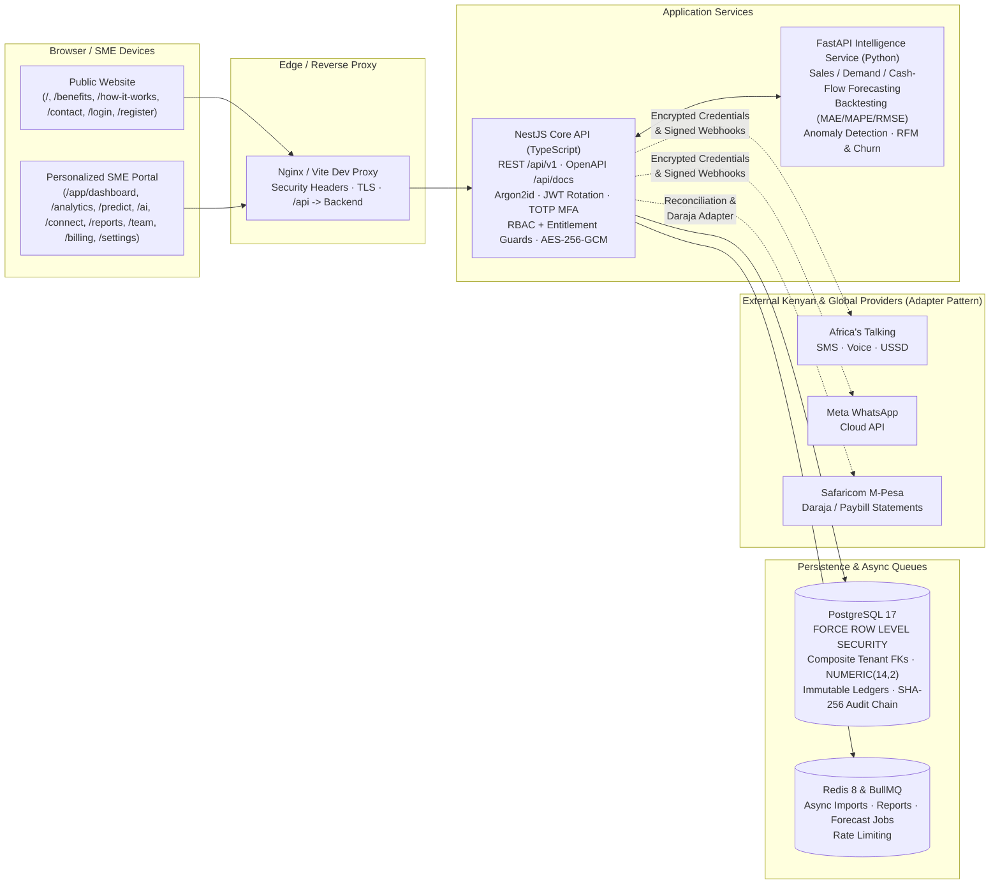

# BizWave System Architecture & Entity Relationship Diagram (ERD)

## 1. High-Level Platform Architecture

## 2. Database Entity Relationship Diagram (All 13 Schema Groups)

```mermaid
erDiagram
  %% Group 1: Identity, RBAC & Sessions
  USERS ||--o{ USER_SESSIONS : "has refresh sessions"
  USERS ||--o{ USER_MFA_METHODS : "enrolls TOTP"
  USERS ||--o{ USER_TENANT_MEMBERSHIPS : "belongs to orgs"
  TENANTS ||--o{ USER_TENANT_MEMBERSHIPS : "has members"
  ROLES ||--o{ ROLE_PERMISSIONS : "grants"
  PERMISSIONS ||--o{ ROLE_PERMISSIONS : "assigned to"
  USER_TENANT_MEMBERSHIPS ||--o{ USER_ROLE_ASSIGNMENTS : "holds roles"
  ROLES ||--o{ USER_ROLE_ASSIGNMENTS : "defines"

  %% Group 2 & 3: Tenants, Industry Templates & Branches
  INDUSTRY_TEMPLATES ||--o{ TENANTS : "configures workspace"
  TENANTS ||--o{ BRANCHES : "operates"
  USER_TENANT_MEMBERSHIPS ||--o{ USER_BRANCH_ACCESS : "scoped to"
  BRANCHES ||--o{ USER_BRANCH_ACCESS : "authorizes"

  %% Group 4: Integrations & Imports
  TENANTS ||--o{ DATA_SOURCES : "connects"
  DATA_SOURCES ||--o{ IMPORT_JOBS : "ingests via"
  IMPORT_JOBS ||--o{ IMPORT_JOB_ERRORS : "records invalid rows"
  IMPORT_JOBS ||--o{ IMPORT_RECORDS_STAGING : "stages raw JSONB"

  %% Group 5 & 6: CRM, Products & Immutable Inventory
  TENANTS ||--o{ CUSTOMERS : "owns"
  CUSTOMERS ||--o{ CUSTOMER_CONSENTS : "grants DPA consent"
  CUSTOMERS ||--o{ CUSTOMER_SEGMENTS_MEMBERSHIP : "segmented into"
  TENANTS ||--o{ PRODUCT_CATEGORIES : "categorizes"
  TENANTS ||--o{ SUPPLIERS : "sources from"
  TENANTS ||--o{ PRODUCTS : "lists SKUs"
  PRODUCTS ||--o{ INVENTORY_MOVEMENTS : "immutable stock ledger"
  BRANCHES ||--o{ INVENTORY_MOVEMENTS : "tracks per branch"
  PRODUCTS ||--o{ INVENTORY_ALERTS : "triggers reorder alerts"

  %% Group 7 & 8: Sales, Finance & M-Pesa Reconciliation
  BRANCHES ||--o{ SALES_TRANSACTIONS : "records sales"
  CUSTOMERS ||--o{ SALES_TRANSACTIONS : "purchases"
  SALES_TRANSACTIONS ||--o{ SALES_TRANSACTION_ITEMS : "contains lines"
  SALES_TRANSACTIONS ||--o{ SALES_PAYMENTS : "settled via"
  TENANTS ||--o{ EXPENSE_CATEGORIES : "classifies"
  BRANCHES ||--o{ EXPENSES : "incurs"
  TENANTS ||--o{ CASH_ACCOUNTS : "holds M-Pesa/bank/cash"
  CASH_ACCOUNTS ||--o{ CASH_TRANSACTIONS : "reconciles"
  TENANTS ||--o{ PAYABLES_RECEIVABLES : "tracks obligations"

  %% Group 9 & 10: Analytics, Reports & Predict
  TENANTS ||--o{ REPORT_TEMPLATES : "defines"
  REPORT_TEMPLATES ||--o{ SCHEDULED_REPORTS : "schedules"
  REPORT_TEMPLATES ||--o{ REPORT_EXECUTIONS : "executes"
  FORECAST_MODELS ||--o{ FORECAST_RUNS : "runs algorithm"
  TENANTS ||--o{ FORECAST_RUNS : "generates"
  FORECAST_RUNS ||--o{ FORECAST_POINTS : "outputs intervals"
  TENANTS ||--o{ ANOMALY_ALERTS : "flags outliers"

  %% Group 11: BizWave AI
  TENANTS ||--o{ AI_CONVERSATIONS : "hosts"
  AI_CONVERSATIONS ||--o{ AI_MESSAGES : "exchanges"
  AI_MESSAGES ||--o{ AI_TOOL_EXECUTIONS : "audits whitelisted tools"
  AI_MESSAGES ||--o{ AI_FEEDBACK : "captures ratings"

  %% Group 12: BizWave Connect
  COMMUNICATION_PROVIDERS ||--o{ TENANT_COMMUNICATION_CHANNELS : "instantiates"
  TENANTS ||--o{ TENANT_COMMUNICATION_CHANNELS : "stores encrypted creds"
  TENANTS ||--o{ MESSAGE_TEMPLATES : "approves EN/SW"
  TENANTS ||--o{ CAMPAIGNS : "orchestrates"
  CAMPAIGNS ||--o{ MESSAGES : "dispatches"
  MESSAGES ||--o{ MESSAGE_DELIVERY_EVENTS : "tracks signed webhooks"

  %% Group 13: Subscriptions, Billing, Audit & DPA
  SUBSCRIPTION_PLANS ||--o{ PLAN_FEATURES : "entitles"
  SUBSCRIPTION_PLANS ||--o{ TENANT_SUBSCRIPTIONS : "subscribes"
  TENANTS ||--o{ TENANT_SUBSCRIPTIONS : "billed under"
  ADD_ONS ||--o{ TENANT_ADD_ONS : "purchased as"
  TENANTS ||--o{ USAGE_RECORDS : "meters quotas"
  TENANTS ||--o{ AUDIT_LOGS : "SHA-256 hash-chained"
  TENANTS ||--o{ DATA_SUBJECT_REQUESTS : "Kenya DPA 2019"
```

Every tenant-owned table carries `tenant_id UUID NOT NULL` and enforces **composite tenant-aware foreign keys** `(tenant_id, <fk_id>)` alongside **PostgreSQL `FORCE ROW LEVEL SECURITY`** evaluated against `app_current_tenant_id()`.

## 3. Cross-Tenant Isolation Guarantees

1. **Transaction-Scoped RLS**: Every authenticated request opens a PostgreSQL transaction via `DatabaseService.withTenantTransaction()` and runs `SELECT set_config('app.tenant_id', $1, true)` (`is_local = true`). When the transaction ends, the setting automatically clears so pooled connections can never leak tenant context.
2. **Non-Superuser DB Runtime Role**: The API runs exclusively as `bizwave_app` (`NOSUPERUSER NOBYPASSRLS`), meaning PostgreSQL enforces `FORCE ROW LEVEL SECURITY` even on table operations initiated by the application.
3. **Composite Foreign Keys**: Child tables reference `(tenant_id, parent_id)` instead of `parent_id` alone, making it structurally impossible at the storage engine level for a record in Tenant A to link to a branch, product, customer, or sale in Tenant B.
