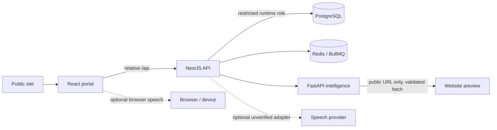
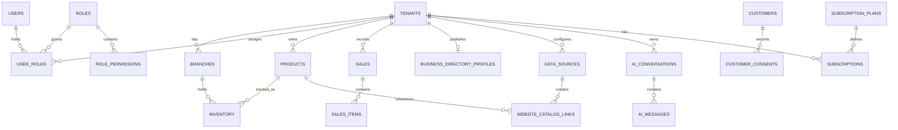

# Architecture and schema map

This is a simplified guide, not a complete entity-relationship diagram. Exact definitions, constraints and row-level-security policies are in `database/migrations/001_*.sql` through `008_*.sql`.

External customer-message delivery, online billing and live M-Pesa/POS integrations are **not connected**. Provider catalog rows are not live links.

`business_directory_profiles` is visible across authenticated tenants only when published; all other operational records remain scoped. `website_catalog_links` tracks source-owned products to avoid overwriting unrelated catalog rows. `ai_conversations.security_scope` preserves creation-time permissions and branches. The analytics materialized view is cross-tenant and therefore not directly granted to the runtime role.
